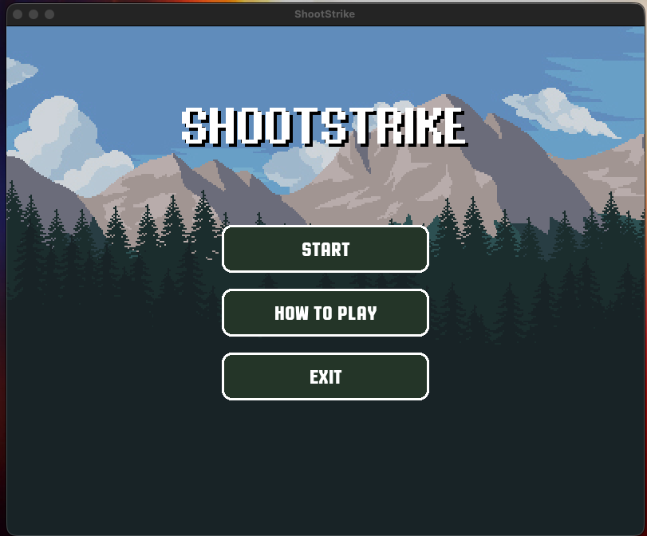

#SHOOTSTRIKE

A 2d horizontal scrolling shooter game i made with pygame. The objective is to get through the 10 levels by either killing the enemy of avoiding them using the help of grenades and supplies and bullets ofc(its a shooter game dawg) and try to reach the exit


I had mostly beginner level experience but i had never experimented with classes and making a game through pygame was a good challenge for it aswell. It was fun lowk. Learnt the basics through the guide of snek 
 and learned the rest from a yt tutorial and expanded upon that with my learnings and suggestions from friends. 


How to run it

You need Python 3 and Pygame 2.0 or newer.

1. Install pygame:
   ```pip install pygame```

2. Open a terminal in the game folder (the one with main.py) and run:
   ```python main.py```

Run it from inside the game folder, otherwise it won't find the images, fonts, sounds and level files.

Controls:
```
A / D - move left and right
W - jump
SPACE - shoot
Q - throw a grenade
P or ESC - pause```

Notes

- Water and falling off the map kill you instantly.
- Your own grenades can hurt you too.
- Health boxes give +25 health, ammo boxes give +15 ammo, grenade boxes give +3 grenades.


## ai usage
ai was used to help me with implementing features like shake , particle chipping off of bullets and items , and it helped me make the main menu and how-to screen look good overall. 
furthermore ai was mostly used to debug some if logics i had used which trigerred an error inside some specific point.
w gemini (student edition) waiting for uranium  in 2030 fr